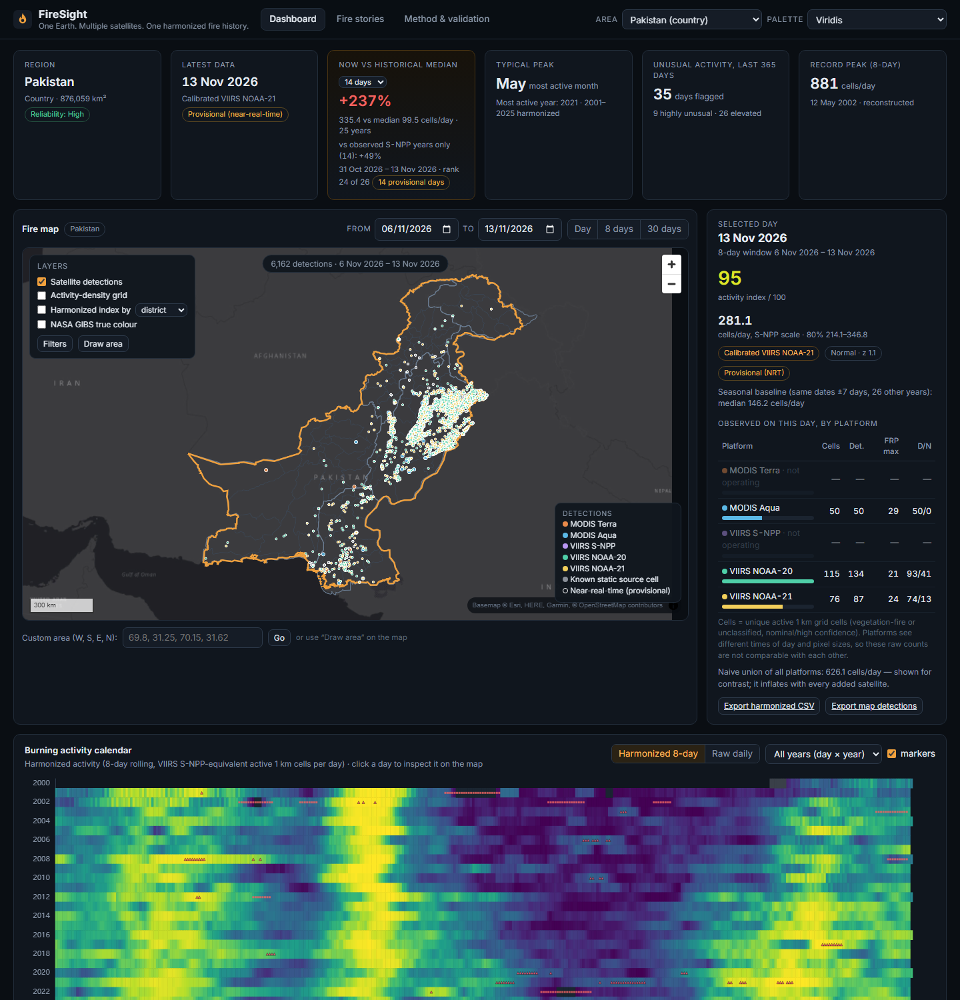
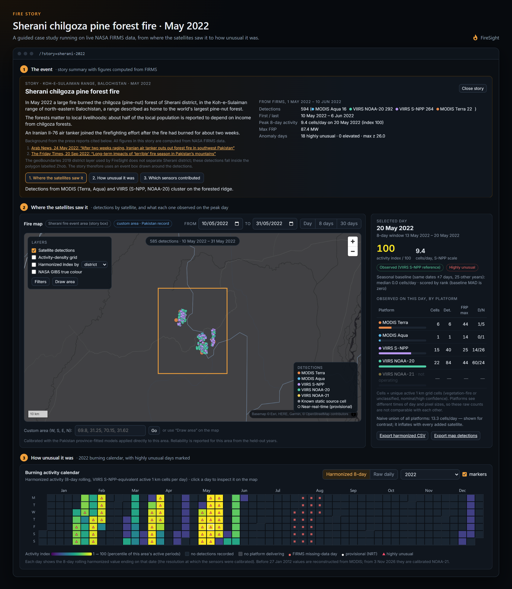
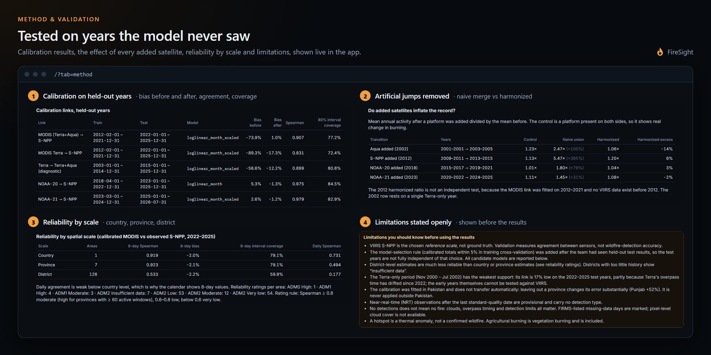
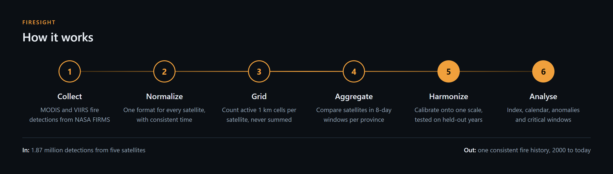
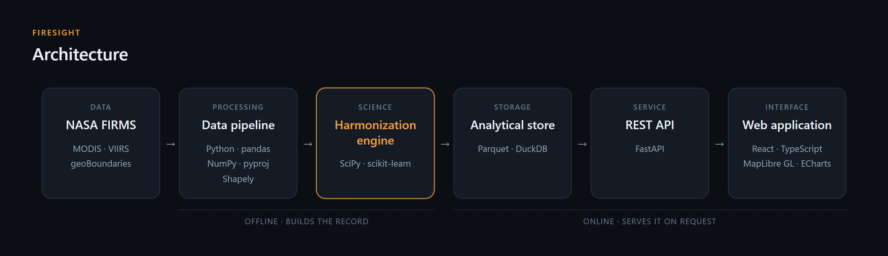

<div align="center">


# FireSight

### One consistent fire history from five NASA satellites

**Harmonizing 25 years of MODIS and VIIRS active-fire detections into a single, tested burning-activity calendar.**

[](https://www.spaceappschallenge.org/2026/challenges/modis-and-viirs-hot-spots/)
[](https://firms.modaps.eosdis.nasa.gov/)
[](.python-version)
[](tests)
[](LICENSE)

*Team FireSight · NASA Space Apps Challenge 2026 · Challenge: [Harmonization of MODIS and VIIRS Hot Spots](https://www.spaceappschallenge.org/2026/challenges/modis-and-viirs-hot-spots/)*

</div>



---

## Contents

- [The problem](#the-problem)
- [Our solution](#our-solution)
- [Key results](#key-results)
- [How it answers the challenge](#how-it-answers-the-challenge)
- [Features](#features)
- [How it works](#how-it-works)
- [Validation](#validation)
- [Limitations](#limitations)
- [Run FireSight locally](#run-firesight-locally)
- [Architecture](#architecture)
- [Data sources and acknowledgements](#data-sources-and-acknowledgements)
- [Use of AI tools](#use-of-ai-tools)

---

## The problem

NASA's Fire Information for Resource Management System (FIRMS) has recorded active-fire hotspots since November 2000. That record comes from **five satellites** with different instruments, pixel sizes and overpass times:

| Instrument | Satellite | In FIRMS since | Pixel size |
|---|---|---|---|
| MODIS | Terra | 2000 | 1 km |
| MODIS | Aqua | 2002 | 1 km |
| VIIRS | Suomi NPP (S-NPP) | 2012 (data end 2 Nov 2026) | 375 m |
| VIIRS | NOAA-20 | 2018 | 375 m |
| VIIRS | NOAA-21 | 2023 | 375 m |

Merging their detections naively creates artificial jumps every time a satellite is added. In Pakistan's FIRMS data, **the merged record jumps 5.5× when VIIRS S-NPP arrives in 2012, while MODIS alone changes only 1.13×.** That jump comes from the satellites, not from more burning. An emergency manager comparing this season with the past cannot tell a real change from a new sensor.

## Our solution

**FireSight turns the five records into one consistent burning-activity history for Pakistan, from November 2000 to the latest available day**, and presents it as an interactive web application built around a **burning-activity calendar**.

It answers the questions a fire manager actually asks:

- **Is there more burning than usual right now?** The selected area's latest 7, 14 or 30 days, compared like for like with the same dates in every previous year.
- **When does this area usually burn?** Recurring critical burning windows and the seasonal pattern.
- **Which periods were truly unusual?** Robust seasonal anomaly detection, ranked by severity.
- **Where, and seen by which satellite?** An interactive map of every detection, down to the source file and row.

Every number comes from NASA FIRMS data. Every result carries its source platform, its method (observed or reconstructed), its uncertainty and its data-quality status.

## Key results

| | |
|---|---|
| **−73.9% → +1.0%** | MODIS vs VIIRS S-NPP total bias, before and after calibration, on held-out years 2022–2025 |
| **+385% → +6%** | Artificial jump in the record when S-NPP was added, naive merge vs FireSight |
| **0.98** | Rank agreement (Spearman) of calibrated NOAA-21 with S-NPP on held-out data |
| **1.87 million** | NASA FIRMS detections processed for Pakistan, 2000–2026, every file checksummed |
| **26 years · 5 satellites · 126 districts** | One continuous daily record for the country, 7 provinces/territories and 126 districts |

## How it answers the challenge

| The challenge asks for… | FireSight provides |
|---|---|
| Harmonize MODIS and VIIRS so the sensor of origin no longer matters | Per-province calibration onto one reference scale, tested on held-out years, with before/after charts in the app |
| A burning-activity calendar from the early 2000s to the present | Day-of-year × year calendar since November 2000, plus a single-year calendar view |
| Select a region and a date range | Country, provinces, districts, drawn polygons, coordinate boxes, and a date-range picker |
| Compare the current period against the historical median | Headline sentence and chart: latest 7/14/30 days vs the same dates in every year |
| Anomalies against multi-year history | Robust seasonal z-scores, ranked unusual episodes, flags on the calendar |
| Critical periods | Recurring critical burning windows per area |
| Accessible colour ramps | Viridis (default), Cividis (colour-vision safe) and YlOrRd |
| Downloadable CSV | Harmonized series and raw detections for any area and period |
| Draw an area or enter latitude/longitude | "Draw area" on the map and a W, S, E, N box |

## Features

| Feature | What it shows |
|---|---|
| **Headline** | One sentence: the latest 7, 14 or 30 days against the same dates in every previous year of the record, with rank, an observed-years-only check and a provisional-data badge. |
| **Burning-activity calendar** | Harmonized 8-day activity for every day since November 2000. Tooltips show index, 80% interval, method, anomaly and data quality. Click a day to open it on the map. A raw daily mode shows any single satellite's own observations. |
| **Fire map** | Detections from all five satellites, with filters for satellite, day/night, sensor-specific confidence, detection type and persistent heat sources. Activity-density grid, harmonized index by district or province, and NASA GIBS true-colour imagery. |
| **Selected-day panel** | Activity index, harmonized value with interval, seasonal baseline, and what each satellite observed that day. |
| **Sensor harmonization** | Naive merge vs raw MODIS vs raw S-NPP vs harmonized, with satellite transitions marked; each satellite's own series; calibration check on the overlap years. |
| **Historical intelligence** | Seasonal pattern, critical burning windows, the latest 14 days against every year, and ranked unusual episodes. |
| **Fire stories** | Guided case studies on the live data: the Sherani chilgoza pine-forest fire (May 2022) and Punjab's two burning seasons. |
| **Data quality** | Reliability rating per area, provisional flags for near-real-time data and FIRMS missing-data days. "No detections recorded" is shown separately from "no satellite delivering". |
| **Export** | Harmonized CSV (per-satellite contributions, uncertainty, method, anomaly, calibration version) and raw-detection CSV (source file and row). |
| **Beyond Pakistan** | Areas outside the processed region are labelled "historical data not acquired" and can fetch recent raw FIRMS detections on demand. Pakistan's calibration is never applied to them. |

### Fire story: Sherani chilgoza pine forest, May 2022

A guided case study on live NASA FIRMS data: the event (with cited press sources), where each satellite saw it, and how unusual it was against the same dates in 25 other years.



### Method & validation

Every calibration is tested on years the model never saw, and the results, the effect of each added satellite, reliability by scale and the limitations are all shown inside the app.



<sub>Full-page captures: [fire story](docs/screenshots/02_story_sherani.png) · [method & validation](docs/screenshots/04_method.png)</sub>

Shareable links:

| Link | Opens |
|---|---|
| `/?story=sherani-2022` | Sherani fire story |
| `/?story=punjab-seasons` | Punjab burning-seasons story |
| `/?aoi=PAK-ADM1-5&date=2025-11-05` | Punjab on 5 Nov 2025 |
| `/?tab=method` | Method & validation page |

## How it works



1. **Collect.** Raw files from the FIRMS country archive (MODIS C6.1 2000–2025, VIIRS S-NPP 2012–2025, NOAA-20 2018–2025) and the FIRMS Area API (NOAA-21, 2026 data and the near-real-time gap). Files are never modified, and each one is checksummed in `data/metadata/manifest.json`.
2. **Normalize.** Every FIRMS file layout is mapped to one schema. The original confidence (whose scales differ between sensors), both brightness channels, pixel size, product version, source file and row are kept. Each detection gets a UTC timestamp and a local solar time.
3. **Grid (spatial aggregation).** Detections are placed on a common **1 km equal-area grid** (EPSG:6933). For each satellite and day, an active cell counts once, which removes most of the pixel-size difference. Satellites are never summed.
4. **Aggregate (temporal aggregation).** Satellites are compared in **fixed 8-day windows per province**. These are long enough to smooth out clouds and overpass gaps, and short enough to resolve the burning seasons; daily navigation is kept.
5. **Harmonize (calibration).** On overlap years, each satellite is mapped onto the **VIIRS S-NPP reference scale**. The model is chosen by blocked-year cross-validation within the training years, with 80% prediction intervals. The record is then carried by one satellite at a time, so it never jumps:

   | Period | Source of the record |
   |---|---|
   | Nov 2000 – Jul 2002 | Calibrated Terra |
   | Jul 2002 – Jan 2012 | Calibrated MODIS (Terra + Aqua) |
   | Jan 2012 – 2 Nov 2026 | Observed S-NPP |
   | From 3 Nov 2026 | Calibrated NOAA-21 |

   Provinces are calibrated directly, the country is the sum of its provinces, and districts receive shares of their province.
6. **Analyse (fire intelligence).**
   - **Activity index (0–100):** the percentile of a day among the area's own active days.
   - **Anomalies:** a robust seasonal z-score, (x − median) / (1.4826 × MAD), against the same dates ±7 days in every other year.
   - **Critical windows:** weeks elevated in at least half of the complete years.
   - **Persistent heat sources:** gas flares, kilns and other industrial sources are classified and can be filtered, never deleted.

## Validation

Computed by [`validation/run_validation.py`](validation/run_validation.py) on years **held out** from training. Full tables: [docs/VALIDATION_REPORT.md](docs/VALIDATION_REPORT.md), and live in the app's *Method & validation* page.

| Calibration link | Train | Test | Total bias before | Total bias after | Spearman | 80% interval coverage |
|---|---|---|---|---|---|---|
| MODIS → S-NPP | 2012–2021 | 2022–2025 | −73.9% | +1.0% | 0.907 | 77.2% |
| NOAA-20 → S-NPP | 2018–2022 | 2023–2025 | +5.3% | −1.3% | 0.975 | 84.5% |
| NOAA-21 → S-NPP | Mar 2023–2024 | 2025 – Jul 2026 | +2.6% | −1.2% | 0.979 | 82.9% |
| Terra → S-NPP | 2012–2021 | 2022–2025 | −89.3% | −17.3% | 0.831 | 72.4% |

How much each satellite transition inflates the record, measured against a control satellite present on both sides:

| Satellite added | Naive merge | FireSight |
|---|---|---|
| Aqua (2002) | +100% | −14% |
| S-NPP (2012) | +385% | +6% |
| NOAA-20 (2018) | +79% | +3% |
| NOAA-21 (2023) | +31% | −2% |

Agreement by spatial scale (8-day Spearman, test years): **country 0.919 · province 0.923 · district 0.533.**

## Limitations

We state these openly; they are also shown inside the application.

- **Reference scale, not ground truth.** VIIRS S-NPP is the chosen reference. Validation measures agreement between sensors, not wildfire-detection accuracy.
- **Model selection.** The selection rule (cross-validated totals within 5%) was added after held-out results had been seen, so the test is not fully independent of that choice. All candidate models are reported.
- **District reliability.** District estimates are much less reliable than province or country estimates (8-day Spearman 0.53 vs 0.92). Each area shows a reliability rating.
- **Terra-only years.** 2000–2002 has the weakest support. Terra's orbit has drifted since 2022 (overpass about 10:50 → 09:20 local time), which affects the test years.
- **Pakistan-only calibration.** The calibration was fitted in Pakistan and is not transferable. With Punjab left out of the fit, Punjab is overestimated by 52%. It is never applied outside Pakistan.
- **Provisional recent data.** Near-real-time data after the last standard-quality date are provisional and carry no detection type.
- **No detection is not no fire.** Clouds, overpass timing and detection limits all affect what is recorded.
- **Hotspots are not confirmed wildfires.** A hotspot is a thermal anomaly; agricultural burning is included as vegetation burning.
- **Sherani boundary.** The 2019 geoBoundaries district layer does not separate Sherani from Zhob, so the Sherani story uses an event box drawn around the detections.

## Run FireSight locally

**Requirements:** Python 3.13, Node.js 20+, about 1 GB of disk space, and internet access for the first download.

1. **Create the Python environment** (Windows `py -3.13`; macOS/Linux `python3.13` and `.venv/bin/python`).

   ```bash
   py -3.13 -m venv .venv
   ```

   ```bash
   .venv/Scripts/python -m pip install -r requirements.lock.txt
   ```

   `requirements.lock.txt` pins the exact tested versions; `requirements.txt` lists the direct dependencies only.

2. **Add a free FIRMS MAP_KEY** (needed for NOAA-21, 2026 data and on-demand areas). Request one at https://firms.modaps.eosdis.nasa.gov/api/map_key/, copy `.env.example` to `.env` and set `FIRMS_MAP_KEY`. Never commit `.env`.

3. **Download the data.** Resumable and checksummed; verified files are skipped on rerun. NASA data are not stored in this repository.

   ```bash
   .venv/Scripts/python scripts/download_data.py --archive --boundaries
   ```

   ```bash
   .venv/Scripts/python scripts/download_data.py --api-full
   ```

4. **Process, validate and precompute.**

   ```bash
   .venv/Scripts/python scripts/run_pipeline.py all
   ```

   ```bash
   .venv/Scripts/python validation/run_validation.py
   ```

   ```bash
   .venv/Scripts/python -c "from backend.services import precompute; precompute.build()"
   ```

5. **Build the web app and start the server**, then open http://localhost:8000.

   ```bash
   cd frontend && npm install && npm run build && cd ..
   ```

   ```bash
   .venv/Scripts/python -m uvicorn backend.api.main:app --port 8000
   ```

For frontend development, run `npm run dev` in `frontend/` (http://localhost:5173, with `/api` proxied to port 8000).

**Tests** (35: parsers, grid, calibration, anomalies, windows, and the API against real data):

```bash
.venv/Scripts/python -m pytest tests -q
```

## Architecture



FireSight has two halves that meet at one analytical store:

- **Offline pipeline (run when new data arrive).** Downloads NASA FIRMS and boundary data, then normalizes, grids, calibrates, harmonizes and validates it, writing every result as Parquet files with a SHA-256 record of each source file.
- **Online application (per request).** A FastAPI service queries those files in-process with DuckDB and returns JSON or CSV to the React web app. No database server is needed, and the whole app runs as one process on a laptop.
- **Runtime services.** The browser loads NASA GIBS imagery and Esri basemap tiles directly. Recent FIRMS data for areas outside Pakistan are requested by the server, so the FIRMS key never reaches the browser.

```
backend/
  ingestion/      downloader (resume, retries, checksums, manifest) and inventory
  processing/     normalizer (all FIRMS layouts), 1 km grid aggregation, persistent sources
  harmonization/  calibration (8-day windows, cross-validated model choice), harmonized record
  analytics/      robust seasonal anomalies, critical burning windows
  services/       custom areas, fire stories, web precompute
  api/            FastAPI app (DuckDB over Parquet); also serves the built frontend
frontend/         React + Vite + TypeScript, MapLibre GL, Apache ECharts
validation/       validation experiments -> results.json
scripts/          data download, processing pipeline, EDA report
docs/             EDA and validation reports, screenshots, diagrams
tests/            pytest suites
data/             metadata (download manifest, data inventory); raw and processed data are not in Git
```

## Data sources and acknowledgements

- **NASA FIRMS:** MODIS Collection 6.1 and VIIRS 375 m active fire products (S-NPP, NOAA-20, NOAA-21) — https://firms.modaps.eosdis.nasa.gov/
- **NASA FIRMS missing-data table** — https://firms.modaps.eosdis.nasa.gov/api/missing_data/
- **geoBoundaries** gbOpen, Pakistan ADM0–ADM2 (2019 edition, public domain) — https://www.geoboundaries.org/
- **NASA GIBS / Worldview** true-colour imagery (optional map layer)
- **Basemap:** Esri World Dark Gray Base (© Esri, HERE, Garmin, © OpenStreetMap contributors)
- **Open-source software:** FastAPI, DuckDB, pandas, NumPy, PyArrow, pyproj, Shapely, SciPy, scikit-learn, React, Vite, TypeScript, MapLibre GL JS, Apache ECharts.

We acknowledge the use of data and imagery from NASA's Fire Information for Resource Management System (FIRMS), part of NASA's Earth Science Data and Information System (ESDIS).

## Use of AI tools

In line with the NASA Space Apps policy on Super Intelligence (SI) tools, we disclose where AI assisted this project. FireSight was developed with the help of **Claude** (Anthropic), used through Claude Code.

| Area | How AI assisted |
|---|---|
| Planning and research | Brainstorming the approach and features; exploring NASA FIRMS data availability and documentation |
| Data analysis | Writing and running the exploratory-analysis and validation scripts; interpreting their results |
| Code | Backend, frontend and tests; debugging and troubleshooting |
| Writing | This README, the EDA and validation reports, and presentation material |
| Visual design | Application layout and styling, the diagrams in `docs/diagrams/`, and the showcase images composed from app screenshots |

- **Data and results are not AI-generated.** Every figure is computed from NASA FIRMS data by the code in this repository and can be reproduced by following [Run FireSight locally](#run-firesight-locally).
- **The team reviewed and tested the work.** Methods, results and limitations were checked by the team, and the automated test suite covers parsers, the grid, calibration, anomalies, windows and the API.
- **FireSight contains no AI assistant or generative model.** Its harmonization uses statistical calibration models fitted to the years in which satellites overlap.
- **Commit metadata records it.** Commits made with AI assistance carry a `Co-Authored-By: Claude` line in the Git history.

## License

Code: MIT License, © 2026 Team FireSight (see [LICENSE](LICENSE)). NASA FIRMS data and geoBoundaries layers are not included in this repository and remain subject to their providers' terms.

<div align="center"><sub>Built by Team FireSight for the NASA Space Apps Challenge 2026.</sub></div>
